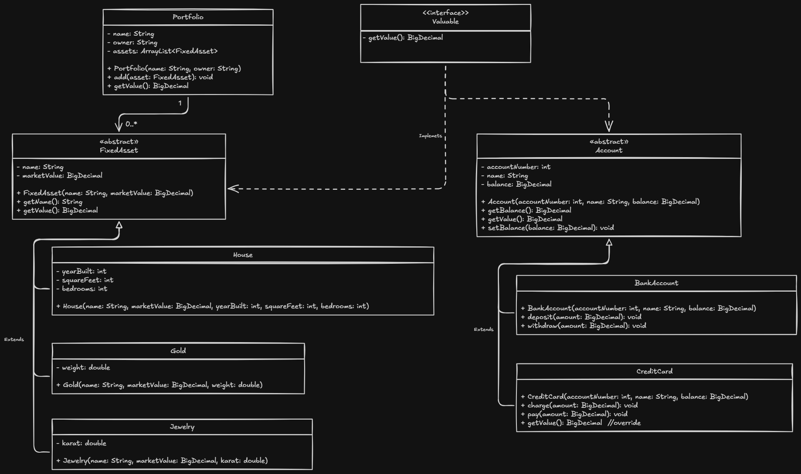

# Diagram

## Q&A

- Did the deposit work for both accounts? Why or why not?:

The deposit worked for account1 but not for `account2`. `account2` is declared as a `Valuable`, 
and that interface only has `getValue()`. Even though the object is really a `BankAccount`, Java only lets you call 
the methods of the variable's type (`Valuable`), so it can't see the deposit method and the code doesn't compile.

- What methods are available for `account1`?

account1 can use `deposit()` and `withdraw()` (from `BankAccount`), plus `getAccountNumber()`, `getName()`, `getBalance()`, 
`setBalance()` and `getValue()` (inherited from `Account`). This is because `account1` is declared as a `BankAccount`, and since 
`BankAccount` extends `Account`, it inherits all of `Account`'s public methods.

- What methods are available for `account2`?

The only method available for `account2` is `getValue()`, because `account2` is declared as a `Valuable`, and the `Valuable` 
interface only defines `getValue()`. It doesn't matter that the real object is a `BankAccount`.

